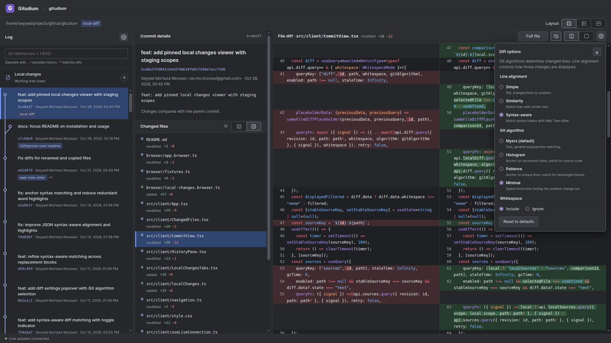

<!--
AI agents maintaining this file: keep the README concise and user-facing.
Focus on what Gitudium is (with a screenshot), downloading and installing it,
and getting started. Keep development guidance brief and use pnpm commands.
Assume readers already know Git and Git GUIs; skip explanations of those basics.
Do not turn this file into a changelog, exhaustive feature list, or implementation
reference. Put detailed technical documentation elsewhere and link it only when
useful. Update instructions, requirements, download links, and the screenshot
when user-visible changes make them inaccurate; do not append notes for every change.
-->

# Gitudium

A local Git viewer in your browser.



## Download and install

**[Download Gitudium](https://github.com/smmoosavi/gitudium/releases/latest/download/gitudium)** · [All releases](https://github.com/smmoosavi/gitudium/releases)

Requires [Bun](https://bun.sh/) **1.3.14 or newer** and [Git](https://git-scm.com/) **2.43.0 or newer**.

Make the downloaded file executable, then move it to a directory on your `PATH`:

```sh
chmod +x ./gitudium
```

## Use

```sh
# Open the repository in the current directory
gitudium
# Or specify a repository
gitudium /path/to/repository
```

Open the **full URL printed in the terminal**, including its `#token=…` fragment.

To choose a different port or see all launch options:

```sh
gitudium --port 8080 /path/to/repository
gitudium --help
```

## Development

With **Node.js 24**, **pnpm 11.17.0**, Bun, and Git installed:

```sh
git clone https://github.com/smmoosavi/gitudium.git
cd gitudium
pnpm install --frozen-lockfile
pnpm run dev
```

Open the full development URL printed in the terminal. To browse another repository, use `pnpm run dev --directory /path/to/repository`.

Run `pnpm test` and `pnpm run typecheck` to check changes. Run `pnpm run build` to create the single-file `gitudium` executable.
